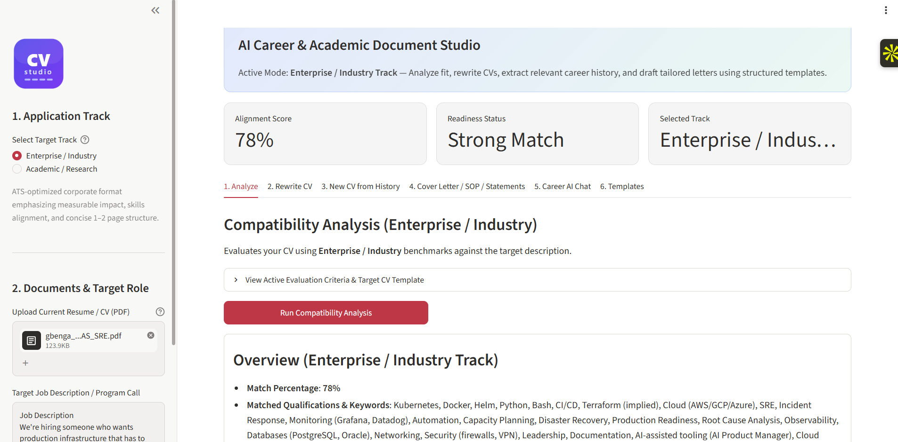

# AI Career & Academic Document Studio

A modular, RAG-powered career and academic application assistant built with **Streamlit**, **LangChain**, **FAISS**, and **Groq**. 

It analyzes CVs against target Job Descriptions or Academic Calls, rewrites existing resumes, extracts relevant experience from a persistent master career archive to build brand-new CVs, drafts tailored statements/letters using customizable templates, and enables interactive RAG chat with your documents.



---

## Key Features

- **Dual Track Support (Enterprise vs. Academic):** Switch between **Enterprise / Industry** (ATS keyword & metric-driven) and **Academic / Research** (publications, grants, teaching, and research fit) evaluation criteria and templates.
- **ATS & Academic Compatibility Analysis:** Scores resume alignment (`0–100%`), identifies matched qualifications, and highlights critical keyword/credential gaps.
- **CV Rewriter & Side-by-Side Diff:** Reframes existing resume bullet points and summaries to match target descriptions without fabricating experience, with a side-by-side comparison view.
- **New CV Builder from Career History:** Paste your entire career archive (past roles, labs, publications, side projects) once-saved locally in `data/user_profile.json`-and automatically extract *only* the relevant experience needed for a specific role.
- **Tailored Letters & Statements:** Generates structured **Cover Letters**, **Statements of Purpose (SOP)**, **Motivation Letters**, and **Research Statements** grounded in your real background.
- **In-App Template Studio:** Edit, customize, and persist your own Markdown evaluation rules and output templates directly in the UI.
- **Interactive RAG Career Chat:** Conversational retrieval chain (`MMR` search over `FAISS` embeddings) to query your uploaded PDF or full career archive.
- **One-Click Export:** Download any generated CV, cover letter, or statement as an ATS-friendly **Microsoft Word (`.docx`)** or **Markdown (`.md`)** file.

---

## Project Structure

```text
resume_analyzer/
├── app.py                        # Streamlit application entry point
├── requirements.txt              # Python dependencies
├── .env                          # Environment variables (GROQ_API_KEY, GROQ_MODEL)
├── data/
│   └── user_profile.json         # Local persistent storage for career history & custom templates
├── backend/
│   ├── llm.py                    # Shared ChatGroq LLM initialization
│   ├── templates.py              # Default Enterprise & Academic CV and Letter templates
│   ├── storage.py                # Local JSON persistence manager
│   ├── analysis.py               # Compatibility analysis & match score extraction
│   ├── cv_builder.py             # Existing CV rewriter & historical CV builder
│   ├── doc_generator.py          # Cover Letter, SOP, Motivation & Research Statement generator
│   ├── exporters.py              # Markdown-to-DOCX (.docx) exporter
│   ├── pdf_ingestion.py          # PDF loader and text splitter
│   └── vector_store.py           # HuggingFace embeddings & FAISS vector store
└── frontend/
    ├── main_app.py               # Sidebar, KPI banner & workspace tab router
    ├── ui_helpers.py             # Shared CSS styling, download bar & context helpers
    ├── chat_interface.py         # Conversational RAG chat interface
    └── tabs/
        ├── analyze_tab.py        # Tab 1: Compatibility Analysis
        ├── rewrite_tab.py        # Tab 2: Rewrite Existing CV
        ├── new_cv_tab.py         # Tab 3: Build New CV from History
        ├── letters_tab.py        # Tab 4: Letters & Academic Statements
        └── templates_tab.py      # Tab 6: Template Customization Studio
```

---

## Installation & Setup

### 1. Clone the Repository
```bash
git clone https://github.com/jagkt/cv_studio.git
cd cv_studio
```

### 2. Create & Activate a Virtual Environment
```bash
python3 -m venv venv
source venv/bin/activate
```

### 3. Install Dependencies
```bash
pip install -r requirements.txt
```

### 4. Configure Environment Variables
Create a `.env` file in the project root:
```env
GROQ_API_KEY="your-groq-api-key"
GROQ_MODEL="openai/gpt-oss-20b"
```

### 5. Run the Application
```bash
streamlit run app.py
```
Open your browser to `http://localhost:8501`.

---

## Privacy & Local Data
- Uploaded PDFs are processed temporarily in memory/disk and immediately cleaned up after indexing.
- Your saved career archive and customized templates are stored locally in `data/user_profile.json` (excluded from Git via `.gitignore`).
